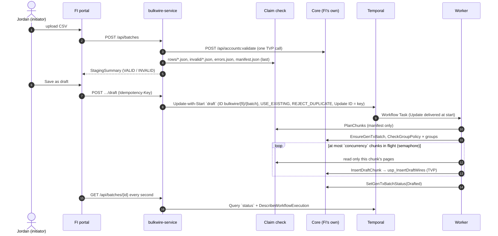
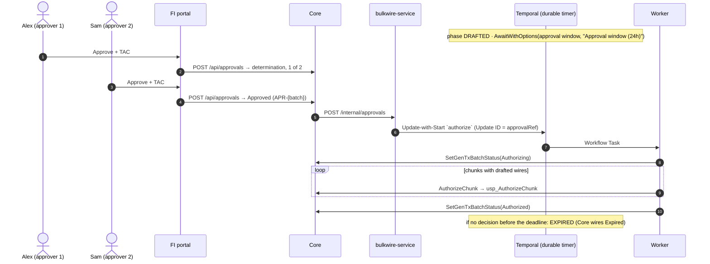
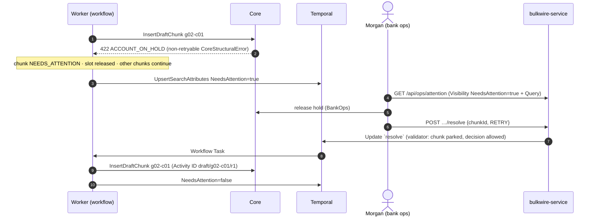

# Architecture

A commercial banking customer uploads a CSV of up to 10,000 outgoing wires. **One Temporal workflow per batch**
(`BulkWireBatch`) drafts every valid wire into the financial institution's core system ("Core") in chunks, waits
durably for Core's approval decision, then authorizes every wire. Infrastructure failures are retried in place;
anything that needs a human **parks inside the workflow** until bank operations decides. Nothing leaves Temporal.

## Topology

```
  Lakeshore portal :3001     Prairie portal :3002        Demo Control Center :3100
  (FI-branded login)         (FI-branded login)          (presenter only, not bank-branded)
          │                          │                              │
          └──────────────┬───────────┘                              │
                         ▼                                          ▼
          ┌────────────────────────────────────────┐   ┌────────────────────────────┐
          │ gateway (nginx): 3 server blocks       │   │ control-service (Go)       │
          │ /api/bulkwire → bulkwire-service       │   │ DEMO-ONLY: chaos via the   │
          │ /api/core     → core-{that FI}         │   │ Docker API (allowlist),    │
          │ /api/control  → control-service (3100) │   │ Core faults, load,         │
          └──────┬─────────────────────────┬───────┘   │ Core queue limits, key     │
                 │                         │           │ rotation, raw-vs-decoded   │
                 │                         │           │ history                    │
                 ▼                         ▼           └────────────────────────────┘
   ┌───────────────────────┐    ┌───────────────────────┐  ┌───────────────────────┐
   │ bulkwire-service (Go) │ ◀──│ core-lakeshore (.NET) │  │ core-prairie (.NET)   │  one Core per FI
   │ login, staging,       │ ◀──│ approvals, TVP        │  │ approvals, TVP        │
   │ Update-with-Start,    │    └───────┬────────────┴──┘  └───────┬────────────┴──┘
   │ Query, Describe,      │            ▼            ▲             ▼            ▲
   │ Visibility            │    ┌────────────────┐   │     ┌────────────────┐   │
   └────┬───────────┬──────┘    │ sql-lakeshore  │   │     │ sql-prairie    │   │     one DB server per FI
        │ claim     │ gRPC      └────────────────┘   │     └────────────────┘   │
        │ check     │                                │                          │
        │           │                                │  Activities (HTTP)       │
        ▼           ▼                                │                          │
 ┌────────────┐  ┌─────────────────┐     ┌───────────┴──────────────────────────┴─────┐
 │ Redis | S3 │  │ temporal (dev   │◀────│ worker-a, worker-b (Go), each polling:     │
 │ | fake-GCS │  │ server, ns      │     │  bulkwire: BulkWireBatch + PlanChunks      │
 │ (one)      │  │ "bulkwire", UI) │     │  bulkwire-core-lakeshore: Core Activities  │
 │            │  │                 │     │  bulkwire-core-prairie:   Core Activities  │
 └────────────┘  └─────────────────┘     └────────────────────────────────────────────┘
          codec-server (Go) ◀── Temporal Web UI and CLI decode encrypted payloads
```

The S3 backend runs RustFS, an S3-compatible server (MinIO no longer ships container images).

## Services and responsibilities

| Service | Responsibility | Key files |
|---|---|---|
| `temporal` (dev server) | Durable execution, namespace `bulkwire`, Visibility, Web UI (:8233). Fairness on, task queues single partition. | `docker-compose.yml` |
| `temporal-init` | One-shot: namespace + the five Search Attributes, then verifies them. | `scripts/temporal-init.sh` |
| `worker-a`, `worker-b` | Each process runs one SDK worker on the shared queue `bulkwire` (`BulkWireBatch` and `PlanChunks`) and one per Core queue in `config/routing.yaml` (the Core Activities, with that queue's rate limit and per-worker cap, and Core credentials for that queue's FIs only). Build `v1`, **Pinned** under Worker Versioning; encrypting DataConverter; Prometheus metrics. | `go/cmd/worker`, `go/internal/workflow`, `go/internal/activities`, `go/internal/routing` |
| `worker-activate` | One-shot: makes `v1` the deployment's Current Version. | `scripts/worker-activate.sh` |
| `bulkwire-service` | Stateless API: demo sign-in, synchronous staging into the claim check, Update-with-Start commands, `status` Query + Describe telemetry (with degraded mode), Visibility lists, the ops exception queue, Core callbacks. | `go/internal/api` |
| `codec-server` | Decrypts payloads for the Web UI and CLI with the same keyring. | `go/cmd/codec-server` |
| `core-lakeshore`, `core-prairie` | One FI's core banking stand-in each: account validation, Core batch lifecycle, wire writes through stored procedures with TVPs, approvals (TAC, determination, dual control). 30 s SQL timeout. | `core/CoreApi` |
| `sql-lakeshore`, `sql-prairie` | One SQL Server per FI; schema, TVP types, idempotent procedures, seeds. | `sql/` |
| Claim-check backend | Immutable store for staged rows and the manifest (Redis with AOF + noeviction, S3, or GCS). | `go/internal/claimcheck`, `go/internal/staging` |
| `gateway` | nginx: two FI-branded portal origins (each routed to its own Core) and the Control Center. | `gateway/` |
| `control-service` + Control Center | **DEMO-ONLY** presenter tooling: chaos, faults, load, Core queue rate limits, keys, versioning walkthrough, reset. | `go/internal/control`, `control-ui/` |

Production-shaped services contain only small, labeled `DEMO-ONLY` hooks (Core fault middleware and admin API,
the draft-defaults hook in bulkwire-service, the compile-time demo bug in the workflow). Everything else that
exists for the demo lives in control-service.

## The life of a batch

### Staging and draft



### Approval and authorization (Core decides, the workflow waits)



### Failure: park and resolve



Transient failures (503, 504 SQL timeout, network, a hung Core past the 60 s StartToClose) never reach the
workflow: the Activity's RetryPolicy retries them in place with exponential backoff and **no attempt cap**,
bounded only by the ScheduleToClose retry budget. If the budget runs out, the chunk parks with
`RETRY_BUDGET_EXHAUSTED`.

Update-with-Start is not atomic: if the execution starts but its first Update is never accepted (no worker was
polling and the caller gave up), nothing else would ever arrive. So the workflow's first wait has a timeout, the
batch's approval window: a batch that receives no `draft` or `authorize` within it closes as CANCELLED instead of
sitting in DRAFTING forever. In the normal case the Update arrives in the first Workflow Task and the timer never
reaches the history.

## Task queues and Core load

| Task queue | Runs | Limits |
|---|---|---|
| `bulkwire` (shared) | The `BulkWireBatch` workflow and `PlanChunks`, which only reads the claim check | none beyond each worker's own caps |
| `bulkwire-core-lakeshore` | Every Activity that calls Lakeshore's Core: `EnsureGenTxBatch`, `CheckGroupPolicy`, `InsertDraftChunk`, `AuthorizeChunk`, `RejectChunk`, `SetGenTxBatchStatus` | 10 Activities/s (server-enforced), 8 per worker |
| `bulkwire-core-prairie` | The same Activities for Prairie's Core | 10 Activities/s, 8 per worker |

`config/routing.yaml` maps each FI to its Core queue and sets each queue's `activitiesPerSecond` and
`maxConcurrentActivities`; the mapping is configuration, never derived from the FI ID. bulkwire-service resolves a
batch's queue and fairness key when it starts the workflow (both entry points: the portal's Draft and Core's
approval callback) and passes them in the workflow input. The workflow schedules every Core Activity with those
values and never reads configuration itself, so a batch keeps the queue it started with even if the file changes
while it runs. Every service validates the file at startup: each FI in exactly one queue, no empty queue, positive
limits.

Each worker process runs one SDK worker per Core queue, registering only the Core Activities, with
`TaskQueueActivitiesPerSecond` from `activitiesPerSecond` and `MaxConcurrentActivityExecutionSize` from
`maxConcurrentActivities`, and Core clients for exactly the FIs that queue serves: a worker on
`bulkwire-core-lakeshore` holds no credentials for Prairie's Core. Every Core Activity first checks that its FI is
one this worker serves; if not (a routing misconfiguration), it fails with the non-retryable `WrongFiRouting`
error and the chunk parks for an operator.

**What limits what.** The rate limit caps how fast Core Activities *start* on a queue, across all of that FI's
batches and all workers. It does not cap how many run at once: with per-call latency L, steady-state in-flight
calls are about rate × L. The number in flight is bounded by each batch's semaphore (chunk concurrency, default 4,
per FI in `fiDefaults`) and by each worker's `MaxConcurrentActivityExecutionSize`. A slow or stopped Core, or
stopped Core workers, back up only that FI's queue; the other FI never notices.

**Fairness.** On a queue that serves one FI, every Core Activity carries `Priority.FairnessKey` = its batch ID.
Fairness only matters when the queue has a backlog (the rate limit or the workers are the bottleneck): the
Temporal Service then dispatches round-robin across fairness keys, so a 500-wire batch is not stuck behind several
5,000-wire ones. Without a backlog every task is dispatched at once and Fairness changes nothing. Because each
batch's semaphore already keeps at most `concurrency` of its tasks in the queue, the effect is modest; the
measured comparison is in the failure catalog (F48). The workflow start sets no Priority; shared-queue Activities
carry no fairness key.

**Shared database clusters.** Several FIs whose Cores share one database cluster can share one Core queue (list
them under one queue's `fis`; an example is commented out in `config/routing.yaml`). The queue's rate limit then
protects the cluster they share, its worker holds Core clients for all of those FIs, and the fairness key becomes
the FI ID, so one FI's batches cannot crowd out another's on the shared cluster.

**Changing the rate limit without a deployment.** A server-side override replaces the workers' value until it is
cleared:

```
temporal task-queue config set --task-queue bulkwire-core-lakeshore --task-queue-type activity \
  --namespace bulkwire --queue-rps-limit 2 --queue-rps-limit-reason "Core maintenance"
```

`make ratelimit FI=lakeshore RPS=2` looks the queue up in `config/routing.yaml` and runs that command;
`RPS=default` clears the override. The Control Center does the same with the `UpdateTaskQueueConfig` RPC and shows
the configured value, any override, and the enforced rate; its reset clears every override.

**Worker Versioning.** The workflow is Pinned. A pinned workflow's Activities are dispatched to its own deployment
version on whatever task queue they target, so each version needs at least one poller on the shared queue and on
every Core queue. Every worker registers with the same deployment name and build ID; in this demo every worker
process polls all three queues. Per-FI Core worker processes would also satisfy the rule, and are the shape to use
when one FI's Core capacity (or credentials) must be operated separately: a `worker-shared` container polling only
`bulkwire`, plus one `worker-core-<fi>` container per Core queue (the same image with a setting that selects which
queues it polls), each deployed with every build. A build may become Current only once its version has pollers on
`bulkwire` and on every Core queue, so the activation step must check all of them, not only the workflow queue.

## Chunk size and the history guard

Chunk size depends on the downstream call, not only on SQL behavior. This Core takes one stored-procedure call per
chunk with a Table-Valued Parameter, so a few hundred wires per call suits it (default 250). A downstream that takes
one HTTP request per wire may need small chunks, or one Activity per batch that heartbeats its progress as a
checkpoint. Chunk size is configuration with no artificial floor: anything from 1 to the maximum batch size.

What bounds a batch is its chunk count, because every chunk adds events to one workflow history. Measured from a
captured history (23 chunks, drafted and authorized: 324 events), each chunk costs at most 12 events and each
group 6; `MAX_CHUNKS_PER_BATCH` (default 1,300) keeps draft plus authorization under 25,000 events even if every
chunk were its own group, well inside the 51,200-event limit. The arithmetic is in
`go/internal/config/config.go` (`MaxChunksPerBatchDefault`). Staging rejects a file that would exceed it, with the
reason on the review screen, so nobody can draft or approve it; bulkwire-service checks again before
Update-with-Start, in case the chunk size changed since staging. Batches beyond that need Continue-As-New or child
workflows that each own a segment of the batch; this implementation does not do either.

## What is deliberately absent

| Absent | Why |
|---|---|
| A dead-letter queue | A failed chunk parks *inside* its workflow, with its full context, and resumes on an operator's `resolve` Update; there is nothing to replay from outside. |
| A reconciler | Core writes are idempotent by wire ID and return chunk-level totals, so a retried or lost-response attempt reports the truth; there is nothing to reconcile. |
| Child workflows | One batch is a few hundred events at the default chunk size, and the chunk count is capped (`MAX_CHUNKS_PER_BATCH`); chunks are Activities bounded by a workflow semaphore, so children would add coordination without solving a problem. |
| A second workflow type | Draft, the durable wait for approval, and authorization are one business process with one ID; approve-before-draft is just Update-with-Start delivering `authorize` first. |
| State in Redis | The claim check holds immutable staged rows only; all batch state lives in the workflow and is read with a Query. |
| Projection tables / read models | The portal's live view is the workflow's `status` Query (plus Describe for retry telemetry); lists come from Visibility Search Attributes. |
| Signals, Continue-As-New | Every inbound message is an Update with a validator (callers learn synchronously whether it was accepted); the history stays far below limits, so Continue-As-New is unnecessary. |
| `MaximumAttempts`, heartbeats on Core calls | Outages are measured in time, not attempts (ScheduleToClose budget); each Core call is sub-minute, so StartToClose (60 s) detects hangs. |
| A "Partial" technical outcome | Business outcomes (denied groups, screened wires, operator rejections) are results recorded in Core; technical failures park until resolved. |

## Tenancy

One Temporal namespace (`bulkwire`) shared by all FIs, one shared workflow task queue, and one Core Activity task
queue per FI (see "Task queues and Core load"). Tenants are separated by the `FiId` Search Attribute (lists), the
Core queue (dispatch: each FI's Core work has its own rate limit and worker capacity), the FI in every workflow
input (the worker config maps it to that FI's own Core), separate Cores and databases (side effects), Core-queue
workers that hold credentials only for their own FI's Core, and a separate service-to-service token per FI: each
Core holds only its own, and bulkwire-service accepts a callback only for the FI whose token it carries. Each FI
also has its own time zone, so "today" for process dates is the FI's local business day. The alternative, a
namespace per FI, gives harder isolation (separate limits, retention, access control) but multiplies namespaces
and worker fleets to operate.

## Security

Every payload (workflow input/result, Activity inputs/results, Update arguments/results, Query results, failure
details, user-metadata summaries) is encrypted with AES-256-GCM before it reaches the Temporal Service; the Codec
Server decrypts for the Web UI and CLI. This DataConverter and Codec Server are an example of the pattern. An
organization that already runs its own Payload Codec and Codec Server should configure that on the workers and
clients instead: every client and worker receives its DataConverter through `temporalx.Dial` (the
`codec.NewDataConverter` calls in `go/cmd/*`), and the Web UI and CLI point at that organization's Codec Server. Search Attributes, IDs, Update names, and failure messages and stack traces
are not payloads, so they are stored unencrypted and must carry no PII: account numbers are masked (`••0033`)
everywhere they could appear, and Core's error messages pass through a redaction guard (any run of 8+ digits is
masked) before they can become a failure message.

Approval decisions never trust the browser for the facts that drive them. After the draft, Core uses its own batch
record; before it (approve-before-draft), Core reads the staged batch's owner, initiator, and total from
bulkwire-service, server to server, so an approver cannot shrink the amount to stay under their limit or avoid
dual control. Every approval read and decision is scoped to the approver's own company.
