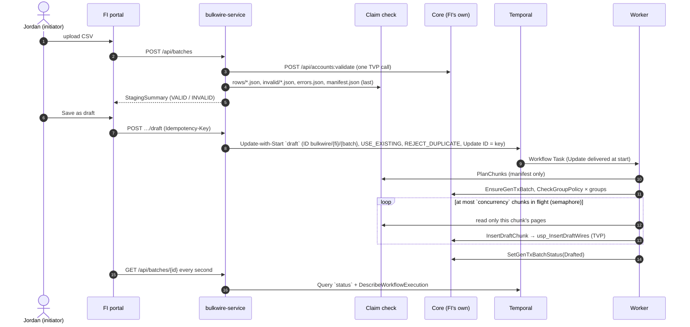
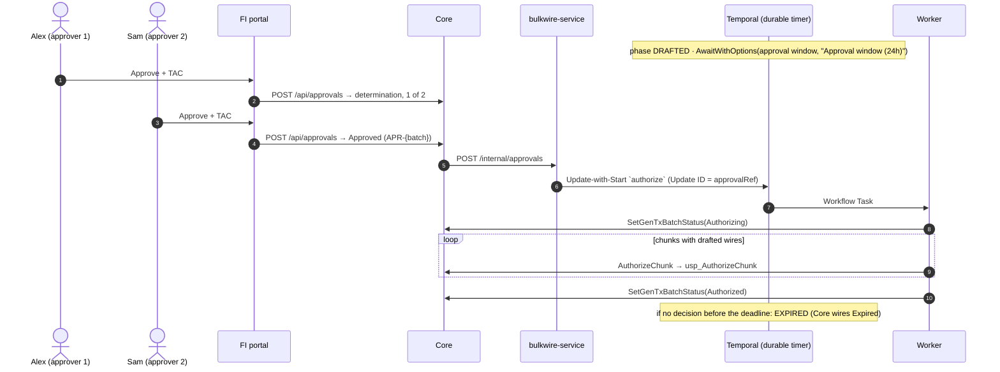
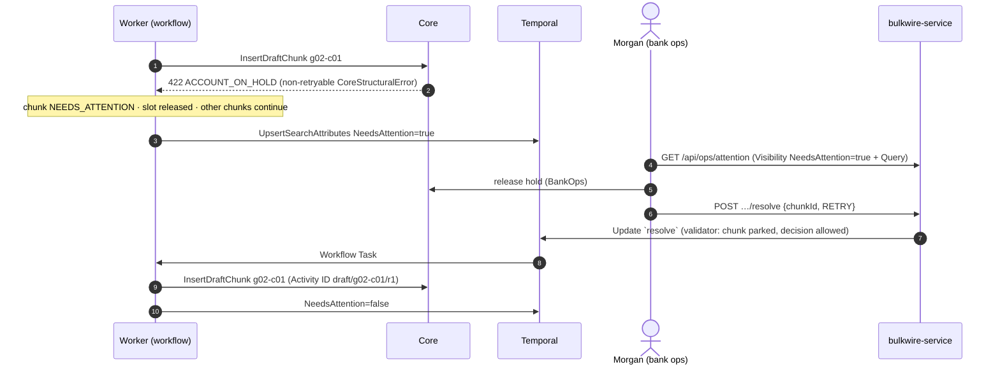

# Architecture

A commercial banking customer uploads a CSV of up to 10,000 outgoing wires. **One Temporal workflow per batch**
(`BulkWireBatch`) drafts every valid wire into the financial institution's core system ("Core") in chunks, waits
durably for Core's approval decision, then authorizes every wire. Infrastructure failures are retried in place;
anything that needs a human **parks inside the workflow** until bank operations decides. Nothing leaves Temporal.

## Topology

```
  Lakeshore portal :3001     Prairie portal :3002        Demo Control Center :3100
  (FI-branded login)         (FI-branded login)          (presenter only, not bank-branded)
          │                          │                              │
          └──────────────┬───────────┘                              │
                         ▼                                          ▼
          ┌────────────────────────────────────────┐   ┌────────────────────────────┐
          │ gateway (nginx): 3 server blocks       │   │ control-service (Go)       │
          │ /api/bulkwire → bulkwire-service       │   │ DEMO-ONLY: chaos via the   │
          │ /api/core     → core-{that FI}         │   │ Docker API (allowlist),    │
          │ /api/control  → control-service (3100) │   │ Core faults, load,         │
          └──────┬─────────────────────────┬───────┘   │ fairness limits, key       │
                 │                         │           │ rotation, raw-vs-decoded   │
                 │                         │           │ history                    │
                 ▼                         ▼           └────────────────────────────┘
   ┌───────────────────────┐    ┌───────────────────────┐  ┌───────────────────────┐
   │ bulkwire-service (Go) │ ◀──│ core-lakeshore (.NET) │  │ core-prairie (.NET)   │  one Core per FI
   │ login, staging,       │ ◀──│ approvals, TVP        │  │ approvals, TVP        │
   │ Update-with-Start,    │    └───────┬────────────┴──┘  └───────┬────────────┴──┘
   │ Query, Describe,      │            ▼            ▲             ▼            ▲
   │ Visibility            │    ┌────────────────┐   │     ┌────────────────┐   │
   └────┬───────────┬──────┘    │ sql-lakeshore  │   │     │ sql-prairie    │   │     one DB server per FI
        │ claim     │ gRPC      └────────────────┘   │     └────────────────┘   │
        │ check     │                                │                          │
        │           │                                │  Activities (HTTP)       │
        ▼           ▼                                │                          │
 ┌────────────┐  ┌─────────────────┐     ┌───────────┴──────────────────────────┴─────┐
 │ Redis | S3 │  │ temporal (dev   │◀────│ worker-a, worker-b (Go)                    │
 │ | fake-GCS │  │ server, ns      │     │ BulkWireBatch + Activities; they read rows │
 │ (one)      │  │ "bulkwire", UI) │     │ from the claim check                       │
 └────────────┘  └─────────────────┘     └────────────────────────────────────────────┘
          codec-server (Go) ◀── Temporal Web UI and CLI decode encrypted payloads
```

The S3 backend runs RustFS, an S3-compatible server (MinIO no longer ships container images).

## Services and responsibilities

| Service | Responsibility | Key files |
|---|---|---|
| `temporal` (dev server) | Durable execution, namespace `bulkwire`, Visibility, Web UI (:8233). Fairness on, task queue single partition. | `docker-compose.yml` |
| `temporal-init` | One-shot: namespace + the five Search Attributes, then verifies them. | `scripts/temporal-init.sh` |
| `worker-a`, `worker-b` | Run `BulkWireBatch` and its Activities on task queue `bulkwire`, build `v1`, **Pinned** under Worker Versioning; encrypting DataConverter; Prometheus metrics. | `go/cmd/worker`, `go/internal/workflow`, `go/internal/activities` |
| `worker-activate` | One-shot: makes `v1` the deployment's Current Version. | `scripts/worker-activate.sh` |
| `bulkwire-service` | Stateless API: demo sign-in, synchronous staging into the claim check, Update-with-Start commands, `status` Query + Describe telemetry (with degraded mode), Visibility lists, the ops exception queue, Core callbacks. | `go/internal/api` |
| `codec-server` | Decrypts payloads for the Web UI and CLI with the same keyring. | `go/cmd/codec-server` |
| `core-lakeshore`, `core-prairie` | One FI's core banking stand-in each: account validation, Core batch lifecycle, wire writes through stored procedures with TVPs, approvals (TAC, determination, dual control). 30 s SQL timeout. | `core/CoreApi` |
| `sql-lakeshore`, `sql-prairie` | One SQL Server per FI; schema, TVP types, idempotent procedures, seeds. | `sql/` |
| Claim-check backend | Immutable store for staged rows and the manifest (Redis with AOF + noeviction, S3, or GCS). | `go/internal/claimcheck`, `go/internal/staging` |
| `gateway` | nginx: two FI-branded portal origins (each routed to its own Core) and the Control Center. | `gateway/` |
| `control-service` + Control Center | **DEMO-ONLY** presenter tooling: chaos, faults, load, fairness, keys, versioning walkthrough, reset. | `go/internal/control`, `control-ui/` |

Production-shaped services contain only small, labeled `DEMO-ONLY` hooks (Core fault middleware and admin API,
the draft-defaults hook in bulkwire-service, the compile-time demo bug in the workflow). Everything else that
exists for the demo lives in control-service.

## The life of a batch

### Staging and draft



### Approval and authorization (Core decides, the workflow waits)



### Failure: park and resolve



Transient failures (503, 504 SQL timeout, network, a hung Core past the 60 s StartToClose) never reach the
workflow: the Activity's RetryPolicy retries them in place with exponential backoff and **no attempt cap**,
bounded only by the ScheduleToClose retry budget. If the budget runs out, the chunk parks with
`RETRY_BUDGET_EXHAUSTED`.

## What is deliberately absent

| Absent | Why |
|---|---|
| A dead-letter queue | A failed chunk parks *inside* its workflow, with its full context, and resumes on an operator's `resolve` Update; there is nothing to replay from outside. |
| A reconciler | Core writes are idempotent by wire ID and return chunk-level totals, so a retried or lost-response attempt reports the truth; there is nothing to reconcile. |
| Child workflows | One batch is a few hundred events; chunks are Activities bounded by a workflow semaphore, so children would add coordination without solving a problem. |
| A second workflow type | Draft, the durable wait for approval, and authorization are one business process with one ID; approve-before-draft is just Update-with-Start delivering `authorize` first. |
| State in Redis | The claim check holds immutable staged rows only; all batch state lives in the workflow and is read with a Query. |
| Projection tables / read models | The portal's live view is the workflow's `status` Query (plus Describe for retry telemetry); lists come from Visibility Search Attributes. |
| Signals, Continue-As-New | Every inbound message is an Update with a validator (callers learn synchronously whether it was accepted); the history stays far below limits, so Continue-As-New is unnecessary. |
| `MaximumAttempts`, heartbeats on Core calls | Outages are measured in time, not attempts (ScheduleToClose budget); each Core call is sub-minute, so StartToClose (60 s) detects hangs. |
| A "Partial" technical outcome | Business outcomes (denied groups, screened wires, operator rejections) are results recorded in Core; technical failures park until resolved. |

## Tenancy

One Temporal namespace (`bulkwire`) and one task queue shared by all FIs: Fairness and per-tenant rate limits
work within a task queue. Tenants are separated by the `FiId` Search Attribute (lists), the Fairness key (dispatch),
the FI in every workflow input (the worker config maps it to that FI's own Core), and separate Cores and databases
(side effects). The alternative, a namespace per FI, gives harder isolation (separate limits, retention, access
control) but gives up cross-tenant fairness on one worker fleet and multiplies namespaces to operate.

## Security

Every payload (workflow input/result, Activity inputs/results, Update arguments/results, Query results, failure
details, user-metadata summaries) is encrypted with AES-256-GCM before it reaches the Temporal Service; the Codec
Server decrypts for the Web UI and CLI. Search Attributes, IDs, Update names, and failure messages are not payloads
and therefore carry no PII: account numbers are masked (`••0033`) everywhere they could appear.
